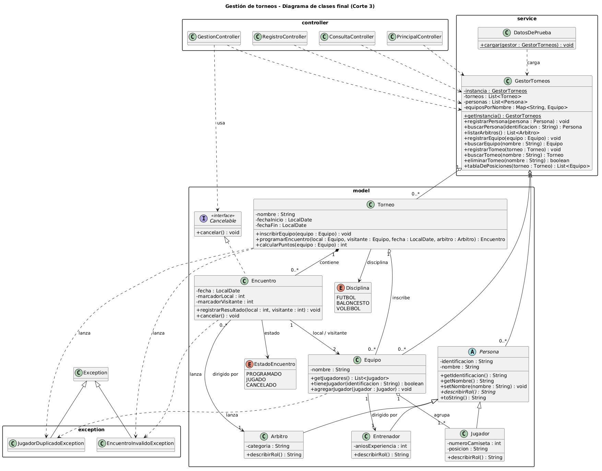

# Corte 3 — Aplicación JavaFX integrada

## Pantallas implementadas

| Vista (FXML) | Controller | Propósito | Captura |
|---|---|---|---|
| `principal.fxml` | `PrincipalController` | Menú principal con un resumen de torneos, equipos y encuentros registrados. | `img/principal.png` |
| `registro.fxml` | `RegistroController` | Formulario para programar un encuentro: torneo, equipo local, equipo visitante, fecha y árbitro. | `img/registro.png` |
| `consulta.fxml` | `ConsultaController` | Tabla con los encuentros de un torneo, con filtro por estado. | `img/consulta.png` |
| `gestion.fxml` | `GestionController` | Registrar resultados, cancelar encuentros y ver la tabla de posiciones. | `img/gestion.png` |


## Navegación

Todas las vistas comparten la misma `Scene`. Para cambiar de pantalla se usa el método `App.cambiarVista("nombreVista")`, que carga el FXML indicado y lo pone como raíz de la escena.

- Desde la pantalla principal, los botones **Programar encuentro**, **Consultar encuentros** y **Resultados y posiciones** llevan a `registro`, `consulta` y `gestion`.
- Cada una de esas tres pantallas tiene el botón **Volver al menú**, que llama a `App.cambiarVista("principal")`.

## Controllers

| Controller | Responsabilidad |
|---|---|
| `PrincipalController` | Muestra el resumen de datos y navega a las demás vistas. |
| `RegistroController` | Llena los ComboBox de torneos, equipos y árbitros, valida que no falten datos y llama a `Torneo.programarEncuentro`. |
| `ConsultaController` | Configura las columnas del `TableView` y muestra los encuentros del torneo elegido, filtrados por estado. |
| `GestionController` | Registra resultados con `Encuentro.registrarResultado`, cancela encuentros a través de la interface `Cancelable` y muestra la tabla de posiciones. |

Todos los Controllers obtienen los datos con `GestorTorneos.getInstancia()`. Ningún Controller contiene reglas del negocio: solo leen los datos de la vista, validan el formato y llaman a métodos del modelo.

## Datos compartidos entre vistas

Cada vez que se cambia de vista, JavaFX crea un Controller nuevo. Para que los datos no se pierdan, `GestorTorneos` tiene una única instancia estática (patrón singleton):

```java
private static GestorTorneos instancia;

public static GestorTorneos getInstancia() {
    if (instancia == null) {
        instancia = new GestorTorneos();
        DatosDePrueba.cargar(instancia);
    }
    return instancia;
}
```

La primera vez que se pide la instancia se cargan los datos de prueba de la clase `DatosDePrueba`: 2 torneos, 4 equipos, 8 jugadores, 4 entrenadores, 2 árbitros y 4 encuentros. Así, un encuentro programado en la pantalla de registro aparece después en la consulta y en la gestión.

## Validaciones

| Vista | Campo / situación | Validación | Mensaje mostrado |
|---|---|---|---|
| Programar encuentro | Torneo | Debe estar seleccionado | "Debe seleccionar un torneo." |
| Programar encuentro | Equipos | Local y visitante seleccionados | "Debe seleccionar el equipo local y el visitante." |
| Programar encuentro | Fecha | Debe estar seleccionada | "Debe seleccionar una fecha." |
| Programar encuentro | Árbitro | Debe estar seleccionado | "Debe seleccionar un árbitro." |
| Programar encuentro | Mismo equipo de local y visitante | Regla del modelo | "Un equipo no puede enfrentarse a sí mismo." |
| Programar encuentro | Fecha fuera del torneo | Regla del modelo | "La fecha del encuentro debe estar entre ... y ..." |
| Programar encuentro | Torneo sin equipos | Se avisa al seleccionarlo | "El torneo ... no tiene equipos inscritos." |
| Resultados | Ningún encuentro seleccionado | Debe elegirse una fila | "Seleccione un encuentro de la tabla." |
| Resultados | Goles vacíos | Ambos campos con texto | "Debe escribir los goles de ambos equipos." |
| Resultados | Goles no numéricos | `Integer.parseInt` con `NumberFormatException` | "Los goles deben ser números enteros." |
| Resultados | Goles negativos | Regla del modelo | "Los marcadores no pueden ser negativos." |
| Resultados | Cancelar encuentro | Se pide confirmación antes | Alert de confirmación |

Ninguna entrada inválida cierra la aplicación: los errores se muestran en una etiqueta roja y, cuando vienen del modelo, también en un `Alert`.

## Manejo de excepciones

Ejemplo del flujo Usuario → Controller → Modelo → Excepción → Controller → Mensaje, al programar un encuentro de un equipo contra sí mismo:

1. El usuario elige Tigres como local y visitante y pulsa **Programar encuentro**.
2. `RegistroController` valida que no falten datos y llama a `torneo.programarEncuentro(...)`.
3. El constructor de `Encuentro` detecta la regla rota y lanza `EncuentroInvalidoException`.
4. El Controller la captura con `try/catch`.
5. Se muestra el mensaje en rojo y en una ventana de error.

```java
// RegistroController.java
try {
    torneo.programarEncuentro(local, visitante, fecha, arbitro);
    lblMensaje.getStyleClass().setAll("exito");
    lblMensaje.setText("Encuentro programado: " + local.getNombre() + " vs "
            + visitante.getNombre() + " el " + fecha + ".");
    limpiarCampos();
} catch (EncuentroInvalidoException e) {
    mostrarError(e.getMessage());
    Alert alerta = new Alert(Alert.AlertType.ERROR);
    alerta.setTitle("No se pudo programar");
    alerta.setHeaderText("Encuentro inválido");
    alerta.setContentText(e.getMessage());
    alerta.showAndWait();
}
```

## Relación interfaz–modelo

- Las clases de `model`, `service` y `exception` no importan nada de `javafx.*`. El mismo modelo funciona desde la consola (`PruebaModelo`) y desde la interfaz gráfica.
- Las reglas del negocio viven en el modelo; los Controllers solo validan el formato de los datos (campos vacíos o números mal escritos) y muestran los mensajes.
- Las tablas leen el modelo con `PropertyValueFactory`, usando los getters: `"fecha"` → `getFecha()`, `"estado"` → `getEstado()`. El paquete `model` está abierto a `javafx.base` en `module-info.java`.
- Los ComboBox y las tablas muestran los objetos con su `toString()`, que devuelve el nombre.
- Las listas internas del modelo se exponen como solo lectura, así que la interfaz no puede saltarse las validaciones.

## Decisiones relevantes

- Se usó una instancia única de `GestorTorneos` para compartir los datos entre todas las pantallas.
- Se cargan datos de prueba al iniciar para facilitar la demostración.
- Los ComboBox de equipos se llenan solo con los equipos inscritos en el torneo elegido.
- La regla de que la fecha del encuentro esté dentro de las fechas del torneo se agregó en el modelo y no en la pantalla, para que se cumpla desde cualquier lugar.
- Se agregó `toString()` a `Persona`, `Equipo` y `Torneo` para mostrarlos por nombre en los controles.
- La cancelación pide confirmación porque no se puede deshacer.
- Las pantallas usan `BorderPane`, `GridPane`, `VBox` y `HBox`, sin posiciones fijas.

## Aspectos pendientes

- No hay pantallas para registrar torneos, equipos o jugadores nuevos; esos datos vienen de los datos de prueba.
- Los datos no se guardan al cerrar la aplicación, porque el examen no requiere persistencia.
- Los setters no repiten las validaciones de los constructores.
- Si se agrega un jugador a un equipo después de inscribirlo en un torneo, no se vuelve a revisar la regla de jugador duplicado en el torneo.

## UML final

Archivo: `docs/corte_3/uml.png` (fuente en PlantUML: `docs/corte_3/uml.puml`)



## Distribución del trabajo

| Integrante | Aportes principales |
|---|---|
| Christopher Chavarria Solorzano | Trabajo individual: pantallas JavaFX, Controllers, navegación, datos compartidos, documento del corte, UML final y README. |
