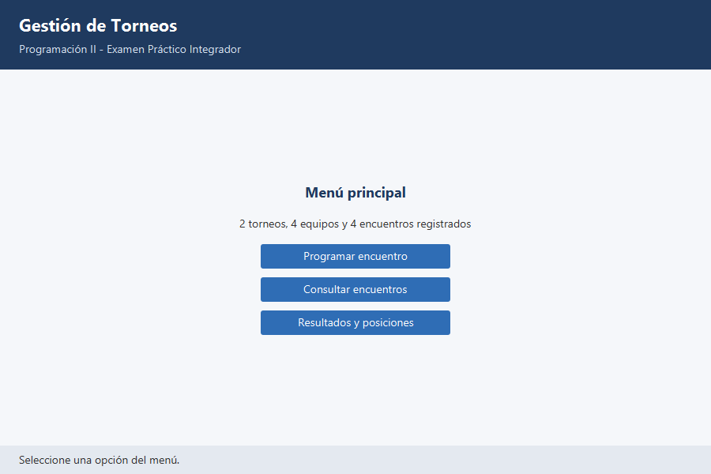
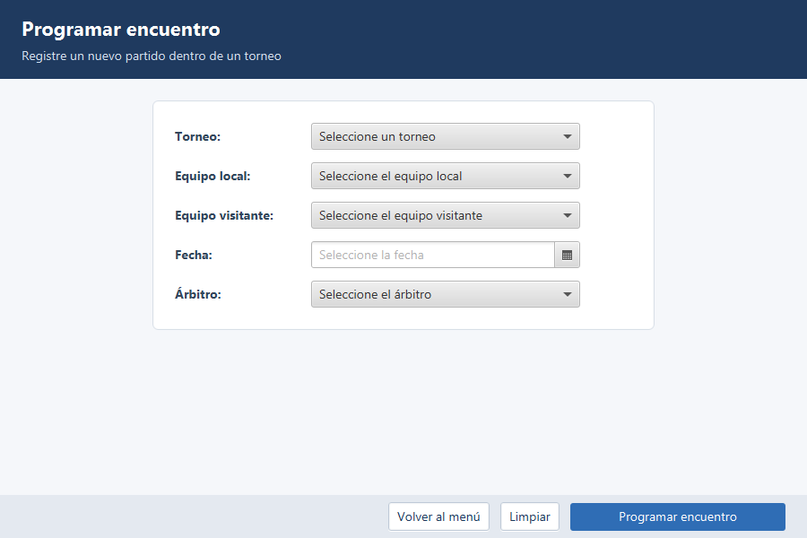
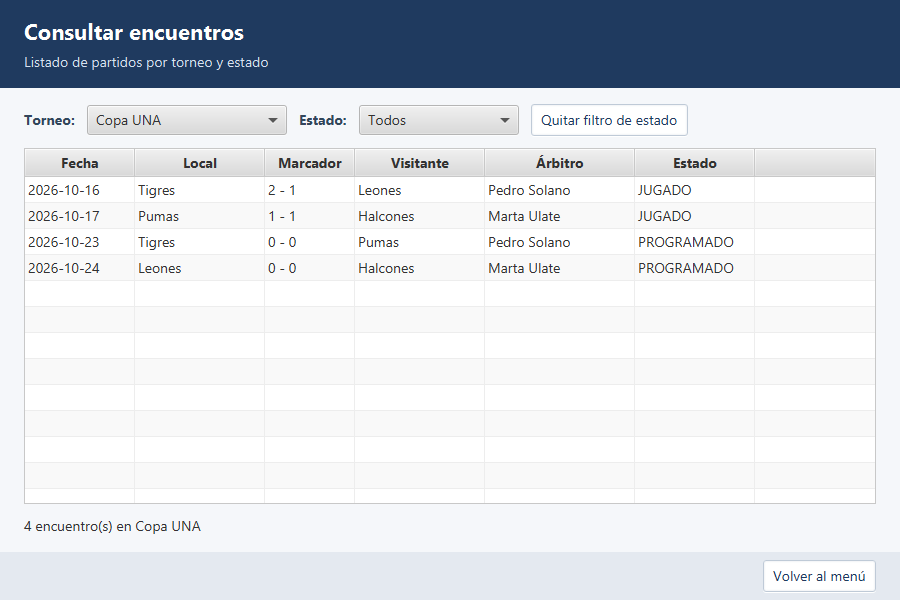
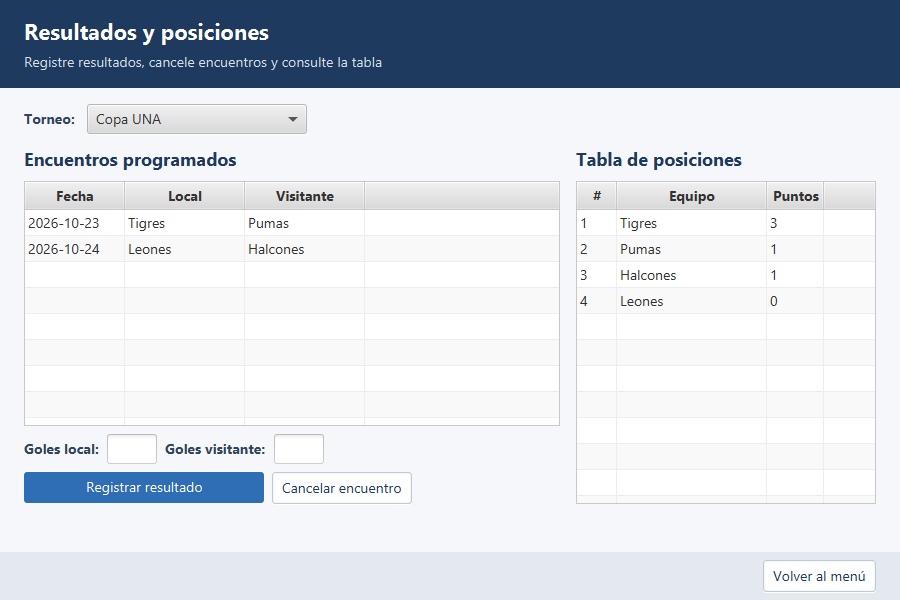

# Gestión de Torneos

Aplicación de escritorio en Java y JavaFX para administrar torneos deportivos: equipos, jugadores, encuentros, resultados y tabla de posiciones.

## Curso

Programación II

## Integrantes

| Nombre | Usuario de GitHub |
|---|---|
| Christopher Chavarria Solorzano | ChristopherChavarria |

Trabajo individual.

## Caso seleccionado

Caso 4. Gestión de torneos

## Descripción del sistema

El sistema está pensado para el personal organizador de un torneo. Permite programar encuentros entre los equipos inscritos, consultar los partidos de cada torneo, registrar resultados, cancelar encuentros y ver la tabla de posiciones.

El sistema aplica las reglas del torneo de forma automática: un jugador no puede estar en dos equipos del mismo torneo, un equipo no puede jugar contra sí mismo, los marcadores no pueden ser negativos y no se registran resultados en encuentros cancelados.

Los datos se manejan en memoria mediante colecciones. Al iniciar, la aplicación carga datos de prueba (2 torneos, 4 equipos, 8 jugadores, 4 entrenadores, 2 árbitros y 4 encuentros).

## Funcionalidades implementadas

- [x] Menú principal con resumen de los datos registrados
- [x] Programar un encuentro entre dos equipos de un torneo, con fecha y árbitro
- [x] Consultar los encuentros de un torneo en una tabla, con filtro por estado
- [x] Registrar el resultado de un encuentro
- [x] Cancelar un encuentro programado
- [x] Tabla de posiciones (3 puntos por victoria, 1 por empate)
- [x] Validación de datos en los formularios y mensajes de error sin cerrar la aplicación
- [x] Navegación entre pantallas conservando los datos
- [x] Prueba del modelo por consola (`PruebaModelo`)

## Estructura del proyecto

```text
proyecto/
├── pom.xml
└── src/main
    ├── java
    │   ├── module-info.java
    │   └── cr/ac/proyecto
    │       ├── App.java
    │       ├── PruebaModelo.java
    │       ├── model/        Persona, Jugador, Entrenador, Arbitro, Equipo,
    │       │                 Torneo, Encuentro, Cancelable, EstadoEncuentro, Disciplina
    │       ├── controller/   PrincipalController, RegistroController,
    │       │                 ConsultaController, GestionController
    │       ├── service/      GestorTorneos, DatosDePrueba
    │       └── exception/    JugadorDuplicadoException, EncuentroInvalidoException
    └── resources/cr/ac/proyecto
        ├── principal.fxml
        ├── registro.fxml
        ├── consulta.fxml
        ├── gestion.fxml
        └── estilos.css
```

## Pasos para ejecutar

```bash
git clone https://github.com/ChristopherChavarria/examen1programacion2-chavarria.git
cd examen1programacion2-chavarria/proyecto
mvn clean javafx:run
```

Desde NetBeans: abrir la carpeta `proyecto/` como proyecto Maven, hacer Clean and Build y ejecutar con la meta `javafx:run`.

Para ejecutar la prueba del modelo por consola, correr la clase `cr.ac.proyecto.PruebaModelo`.

## Tecnologías utilizadas

- Java 21 (compilado con `release 21`)
- JavaFX 21.0.5
- Maven 3.9
- Apache NetBeans 31
- PlantUML (diagramas UML)

## Capturas de pantalla

### Pantalla principal



### Programar encuentro (registro)



### Consultar encuentros



### Resultados y posiciones


